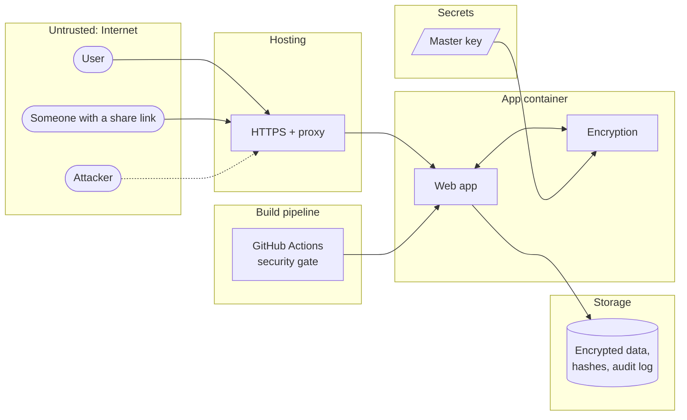

# Secure Vault: Threat Model

Before writing a line of code for my [Secure Vault](https://github.com/funsoi-hub/secure-vault) app, I asked one question: **"How would someone break this?"** This repository is my answer: every realistic attack I could find, how likely and damaging it is, and exactly what in the code stops it.

## Why I did this first

Fixing a security flaw after launch is expensive. Avoiding it in the design is almost free. Threat modelling is how security teams catch problems at the whiteboard stage, and I wanted my app's design to be driven by real threats rather than guesswork.

I also wanted it to be **checkable**. Every threat below links to the control in the code that addresses it, and almost every control has an automated test. You don't have to take my word for it.

## At a glance

| | |
|---|---|
| Threats identified | **35** |
| Fixed with a tested control | **30** |
| Accepted on purpose, with a reason and a plan | **5** |
| Real-world attacker techniques mapped (MITRE ATT&CK) | **17** |
| High risks left at launch | **0** |

## The three lenses I used

| Framework | The question it answers | Where to find it |
|---|---|---|
| **STRIDE** | What can go wrong with each part of the system? | [STRIDE analysis](docs/02-stride.md) |
| **MITRE ATT&CK** | How do real attackers operate, and would we stop or spot each technique? | [ATT&CK mapping](docs/04-attack-mapping.md) |
| **Cyber Kill Chain** | If someone attacked step by step, where does the attack fall apart? | [Kill Chain walkthrough](docs/04-attack-mapping.md#cyber-kill-chain-walkthrough) |

What does STRIDE stand for?

| Letter | Threat | Example in this app |
|---|---|---|
| **S**poofing | Pretending to be someone else | Logging in with a stolen password |
| **T**ampering | Changing data you shouldn't | Editing someone else's note by changing the ID in the URL |
| **R**epudiation | Denying you did something | "I never shared that note" |
| **I**nformation disclosure | Seeing data you shouldn't | Reading notes from a stolen database backup |
| **D**enial of service | Making it unavailable | Flooding the login page |
| **E**levation of privilege | Gaining more access than allowed | Getting past two-factor with a half-finished login |

## The system

The dashed boxes are **trust boundaries**, the lines where data passes between things we trust differently. Every arrow that crosses one is somewhere an attacker could push in, so each one gets examined.

The full version, with what's being protected, who the users are and what I assumed, is in [System model](docs/01-system-model.md).

## Findings that changed my design

This is the part I'm proudest of. Threat modelling only matters if it changes what gets built, and these decisions came straight out of this work:

| What I found | What I changed |
|---|---|
| A leaked database would expose every note | Each user gets their own encryption key, locked by a master key that never touches the database |
| Someone with database access could copy encrypted data between accounts | Each piece of encrypted data is cryptographically tied to its owner, so moved data won't decrypt |
| Chat apps "open" links to show previews, which would use up one-time share links | Opening a shared note now needs a real button click, so previews don't count |
| Share links could leak to other websites through the browser's `Referer` header | The app tells browsers never to send it |
| A stolen login session could be used to switch off two-factor | Switching it off now needs both the password and a fresh code |
| A hijacked build tool could slip a backdoor into the app (this really happened to trivy-action in March 2026) | Every build tool is pinned to an exact version and checked against a known fingerprint |

## Risks I accepted, and why

Not every risk is worth fixing right now. Good security means making those trade-offs openly:

| Risk | Why it's acceptable for now | Plan |
|---|---|---|
| The server holds the master key, so a fully compromised server could read notes | Still blocks the most common case, a leaked database | Encrypt in the browser (end-to-end) |
| Someone with direct database access could delete audit logs | They'd already need deep access | Send logs to tamper-proof storage |
| Sign-up reveals whether an email is registered | Needed for a usable sign-up form; it's rate-limited | Switch to email-verified sign-up |

All five are in the [risk register](docs/05-risk-register.md).

## Read the full model

1. [System model](docs/01-system-model.md): what's protected, who's involved, the full diagram
2. [STRIDE analysis](docs/02-stride.md): all 35 threats, rated, each with its fix and test
3. [Attack trees](docs/03-attack-trees.md): every route to "read someone's notes" and "sneak in malicious code", and which ones are blocked
4. [ATT&CK and Kill Chain](docs/04-attack-mapping.md): real attacker techniques, and an attack followed step by step
5. [Risk register](docs/05-risk-register.md): the accepted risks and their plans

## How I approached it

1. **Drew the system**, marking where trust changes.
2. **Walked every component through STRIDE** to list what could go wrong.
3. **Rated each threat** by likelihood and impact.
4. **Decided:** fix it (and write a test), or accept it (and write down why).
5. **Checked against real attackers** with MITRE ATT&CK and the Kill Chain.
6. **Kept it alive:** I re-review it whenever the design changes.

## What I learned

- **The best fixes come from the design, not the code.** Most of the controls in the app exist because of a line in this model.
- **Attackers think in paths, not single bugs.** Attack trees showed me that blocking one step on each route is enough. That's why two-factor authentication matters so much.
- **Saying "we accept this risk" is a legitimate answer,** as long as it's written down with a reason and a plan.

## Related projects

- [secure-vault](https://github.com/funsoi-hub/secure-vault): the app this models
- [devsecops-pipeline](https://github.com/funsoi-hub/devsecops-pipeline): the security gate that enforces the supply-chain controls

---

Built by **Funso Isola** · [LinkedIn](https://linkedin.com/in/funisola) · [More projects](https://github.com/funsoi-hub)
