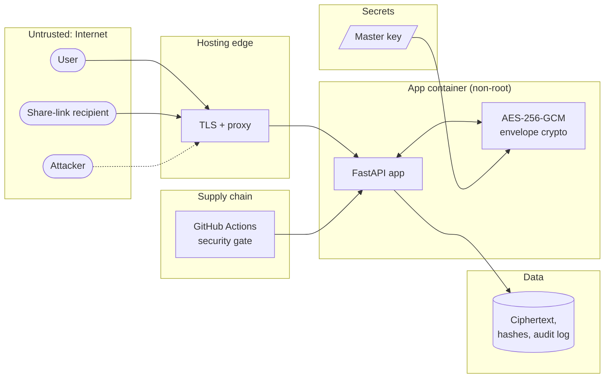

# Secure Vault: Threat Model

A full threat model of [Secure Vault](https://github.com/funsoi-hub/secure-vault), an encrypted notes and file vault, written **before and during** the build so that security drove the design, not the other way round.

It uses three complementary lenses:

- **STRIDE**: what can go wrong with each component and data flow.
- **MITRE ATT&CK**: how real adversaries' techniques would apply, and how each is prevented or detected.
- **Lockheed Martin Cyber Kill Chain**: one realistic attack followed end to end, to show where the chain breaks.

Every threat links to the control in the code that addresses it, and almost every control has an automated test. So the model can be checked, not just read.

## At a glance

| | |
|---|---|
| Threats identified | **35** across all six STRIDE categories |
| Mitigated with a tested control | **30** |
| Accepted, with reasoning and a plan | **5** ([risk register](docs/05-risk-register.md)) |
| ATT&CK techniques mapped | **17** across 8 tactics |
| High residual risks at v1.0 | **0** |

## System overview

The full data-flow diagram, assets, actors, entry points and assumptions are in [System model](docs/01-system-model.md).

## Contents

1. [System model](docs/01-system-model.md): scope, assets, trust boundaries, data-flow diagram
2. [STRIDE analysis](docs/02-stride.md): 35 threats, each rated, with the control and its location
3. [Attack trees](docs/03-attack-trees.md): "read another user's notes" and "ship a backdoor", with blocked and residual paths
4. [ATT&CK and Kill Chain mapping](docs/04-attack-mapping.md): technique-by-technique prevention and detection
5. [Risk register](docs/05-risk-register.md): accepted risks, why, and the plan

## Key findings that changed the design

Threat modelling only matters if it changes what gets built. These are decisions that came directly out of this model:

| Finding | Threat | Design change |
|---|---|---|
| A leaked database would expose every note | I-01 | Envelope encryption with per-user data keys; the master key never touches the DB |
| An attacker with DB access could copy ciphertext between users' rows | T-03 | AES-GCM associated data binds each ciphertext to its owner and field |
| Chat apps "open" links to show previews, which would burn one-view share links | I-07 | Viewing a share needs a deliberate button press (POST); GET only shows a landing page |
| Share tokens could leak through the `Referer` header to other sites | I-06 | `Referrer-Policy: no-referrer` on every response |
| A stolen session could be used to turn MFA off | E-02 | Turning MFA off needs the password and a fresh TOTP code |
| A hijacked GitHub Action tag could backdoor the build (as happened to trivy-action in March 2026) | T-05 | Every action pinned to a commit SHA; scanner binaries verified by checksum |

## Method

1. **Model the system:** draw the data flows and mark trust boundaries; every arrow that crosses a boundary is an entry point.
2. **Find threats with STRIDE:** walk each element and data flow through Spoofing, Tampering, Repudiation, Information disclosure, Denial of service and Elevation of privilege.
3. **Rate them:** likelihood × impact (1–3 each), before controls.
4. **Decide:** mitigate (add a control and a test), or accept (record why, and a plan).
5. **Check against real attackers:** map to MITRE ATT&CK techniques, and walk one full Kill Chain scenario.
6. **Keep it alive:** re-review on every design change, and at least every 6 months.

## Related projects

- [secure-vault](https://github.com/funsoi-hub/secure-vault): the application this models
- [devsecops-pipeline](https://github.com/funsoi-hub/devsecops-pipeline): the CI security gate that enforces controls T-04 to T-06
