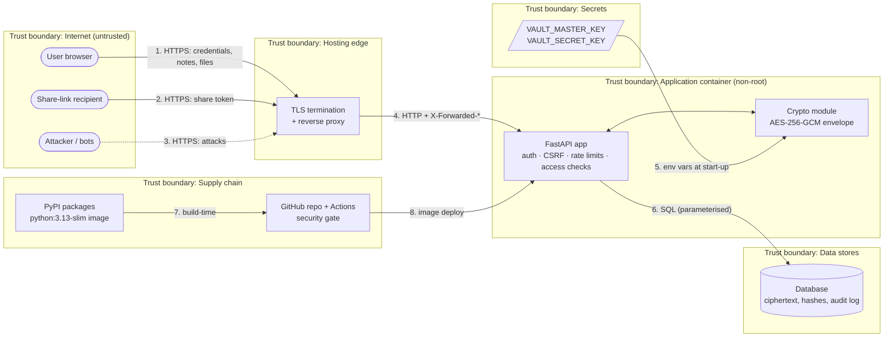

# 1. System model

## Scope

[Secure Vault](https://github.com/funsoi-hub/secure-vault) v1.0: a web app where users store encrypted notes and files, sign in with a password and optional TOTP, and share notes through expiring links. In scope: the web app, its database, its container, the CI/CD pipeline and the hosting edge. Out of scope: the user's own device and browser, and the cloud provider's physical security.

## Assets

| ID | Asset | Why an attacker wants it | Security property |
|---|---|---|---|
| A1 | Note and file contents | The whole point of the vault: secrets, recovery codes, documents | Confidentiality, integrity |
| A2 | Account credentials (password, TOTP seed) | Lead straight to A1 | Confidentiality |
| A3 | Session tokens | Bypass the password and MFA entirely | Confidentiality |
| A4 | Master key (`VAULT_MASTER_KEY`) | Unwraps every user's data key, so every note | Confidentiality |
| A5 | Share-link tokens | Read access to a note without an account | Confidentiality |
| A6 | Audit log | Evidence; attackers want to erase their tracks | Integrity |
| A7 | CI/CD pipeline and source | Plant a backdoor that ships to production | Integrity |
| A8 | Service availability | Users need their recovery codes when things go wrong | Availability |

## Actors

| Actor | Trust | Notes |
|---|---|---|
| Registered user | Trusted for their own data only | May be malicious toward *other* users (IDOR attempts) |
| Share-link recipient | Untrusted | Holds a bearer token, nothing more |
| Anonymous internet | Untrusted | Bots, credential stuffers, scanners |
| Operator (me) | Trusted | Holds the master key; insider risk is noted, not solved (see R-02) |
| Third-party code | Partly trusted | PyPI packages, base images, GitHub Actions |

## Data-flow diagram

Dashed boxes are trust boundaries. Every arrow that crosses one is an entry point and gets analysed in [STRIDE](02-stride.md).

## Entry points

| # | Entry point | Authenticated? |
|---|---|---|
| E1 | `POST /register`, `POST /login`, `POST /login/mfa` | No |
| E2 | Notes, files and account routes | Yes (session + MFA if on) |
| E3 | `GET`/`POST /s/{token}` share links | Bearer token only |
| E4 | `GET /healthz`, `/static/*` | No |
| E5 | Environment variables at start-up | Operator |
| E6 | Pull requests and pushes to GitHub | Repo collaborators |

## Assumptions

1. TLS is terminated by the host with a valid certificate. HSTS is sent by the app.
2. The master key is supplied through the host's secret store, not committed or baked into the image.
3. Only the operator can deploy. Branch protection on `main` requires the security gate.
4. Users' devices aren't compromised. Malware on the endpoint defeats any web app.
