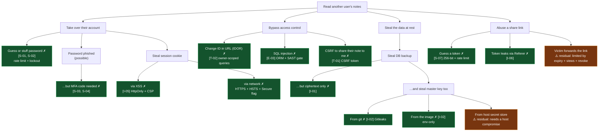
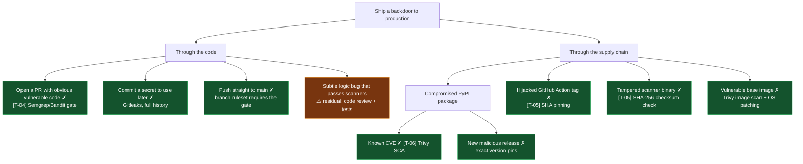

# 3. Attack trees

Attack trees break an attacker's goal into the ways they could reach it. A path is only open if every step along it succeeds. A crossed-out step (✗) is blocked by a control, with the threat ID from [STRIDE](02-stride.md) in brackets.

## Goal 1: Read another user's notes

**Residual paths:** stealing both the database *and* the host's secret store (needs a host compromise, see R-02 and I-11), and social engineering a recipient into forwarding a live link (limited by expiry, view caps and revocation).

## Goal 2: Get malicious code into production

